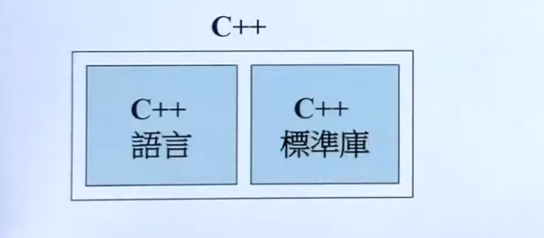
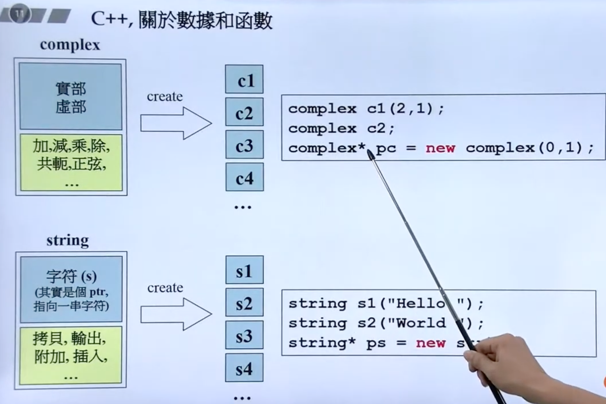

# C++ 面向对象高级编程

[TOC]

## P1 1 C++编程简介
### 目标 

+ 培养正规的，大气的编程习惯
+ 以良好的方式编写 C++ class
  + class without pointer members 
    + Complex
  + class with pointer members
    + String
+ 学习 classes 之间的关系
  + 继承（inheritance）
  + 组合（composition）
  + 委托（delegation）

### C++ 的历史

+ B语言（1969）
+ C语言（1972）
+ C++语言（1983）： new C -> C with Class -> C++


### C++ 演化

+ C++98（1.0）
+ C++03（TR1， Technical Report 1）
+ C++11（2.0）
+ C++14
+ C++17
+ C++20



### 推荐书籍

+ 《C++ Primer》
+ 《The C++ Programming language》
+ 《Effective C++》
+ 《Effective C++ 中文版》
+ 《The C++ Standard Library》
+ 《STL 源码剖析》

## P2 2 头文件与类的声明

### C vs. C++,关于数据和函数

计算机是用于来处理数据的，就分为两类：数据以及处理数据的方法；

C 语言通过 struct 定义**数据类型**，通过**函数**来处理这些**变量**。由于函数和数据是分离的，通常需要依赖全局变量或显式地传参来访问数据。

C++ 是面向对象的语言。它通过 class（或 struct）同时定义数据（**成员变量**）和操作这些数据的方法（**成员函数**），实现了对数据和行为的**封装**。通过类可以创建对象，每个对象都拥有属于自己的数据和操作方法。




### C++ programs 代码基本形式

+ 头文件: .h /.hpp
+ 实现文件：.cpp,.cxx, .mm 等

**Header（头文件）中的防卫式声明**

```C++

#ifndef __COMPLEX__
#define __COMPLEX__

#endif
```

## P3 构造函数


### inline (内敛)函数

+ 函数若在 class 内定义，则该函数就默认成为 inline 函数
+ inline 函数仅仅是对编译器的一种“建议”，最终还是由编译器决定

### public vs private

public: 可以被任意实体访问
private：只允许本类的成员函数访问
protected: 允许本类以及子类进行访问


### constructor (ctro, 构造函数)

```C++

class Complex {
public:
  /// 构造函数
  /// 1. 名称与类名一致 Complex
  /// 2. 没返回类型
  /// 3. 构造函数存在初值列，初始列 (initialization list) `re(r), im(i)` 
  Complex(doulbe r = 0, double i = 0) : re(r), im(i) {}


  /// 构造函数可以有多个
  Complex(): re(0), im(0) {}
};

```

**不带指针的类，多半不需要析构函数**


